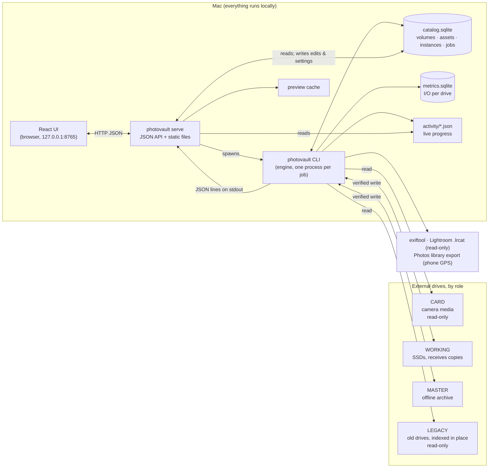
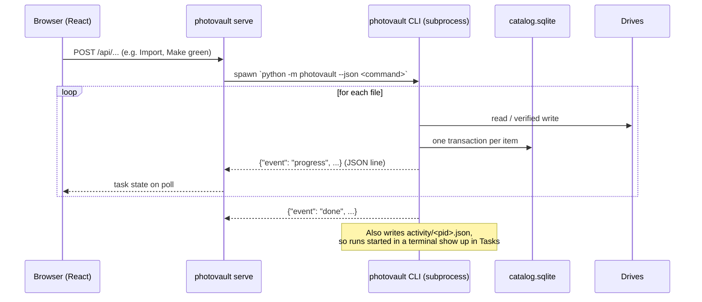
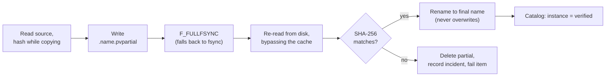
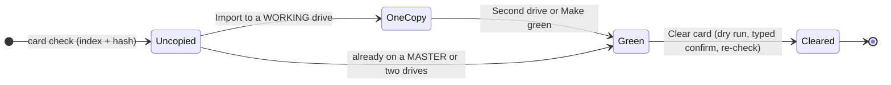
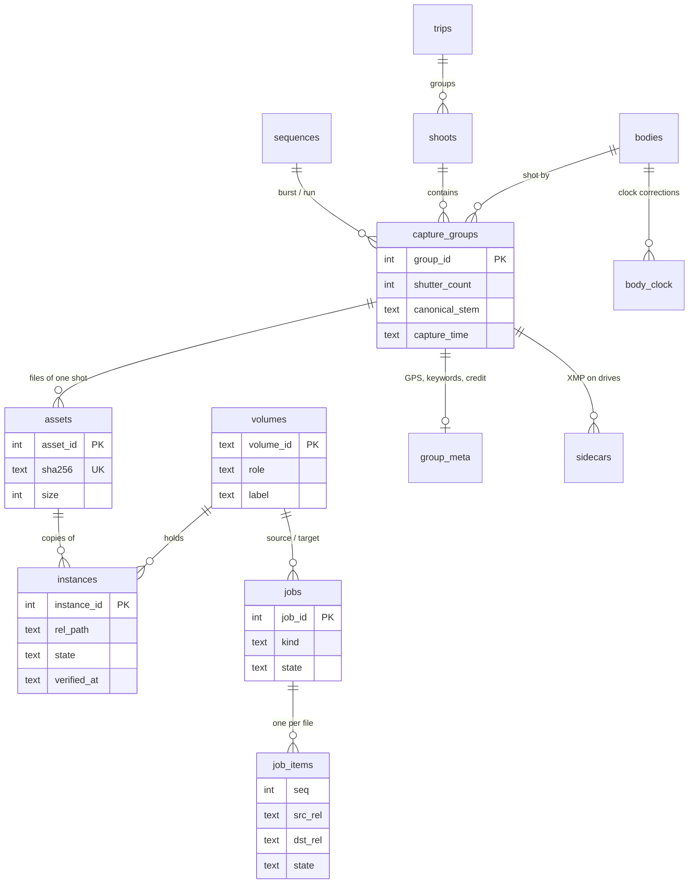

# PhotoVault architecture

PhotoVault imports camera cards onto external drives with byte-verified copies. It tracks every file on every
drive in one SQLite catalog on the Mac, and it tells you, file by file, when a card is safe to clear. This page
describes how the system is built. For the exact signatures and schema, see
[`steering/system-design.md`](steering/system-design.md). For why it is built this way, see
[`ARCHITECTURE_AUDIT_AND_ROADMAP.md`](ARCHITECTURE_AUDIT_AND_ROADMAP.md) and [`decisions.md`](decisions.md).

## 1. The system at a glance

Three ideas carry the design:

1. **A headless engine does all the work.** Every operation that reads a drive or changes the catalog
   (import, backup, index, hash, card check, card clear) is a command of the `photovault` CLI. The command
   prints its progress as JSON lines. The web server never touches a drive directly. It starts the CLI as a
   subprocess and relays the events. So a job started in a terminal and a job started from the UI are the same
   thing, and the UI also shows runs that a terminal started.
2. **The catalog is the contract.** One SQLite file records which drives exist, which files they hold, and
   which copies were verified, and when. Every answer the UI gives ("is this card safe?", "where else does
   this photo live?") is a query over it. Its schema changes only through numbered migrations (now at V8).
3. **Identity is the SHA-256 of the bytes.** File names, sizes, dates and partial hashes only narrow the
   candidates. Two files are the same photo only when their full hashes match.

## 2. Process model

- The server binds to `127.0.0.1` only. It writes small things to the catalog itself (settings, drive names,
  photo edits such as location and keywords), but it never reads or writes a drive's media. That is the engine's job.
- Each item of a job commits in its own transaction. A killed or unplugged run leaves the job `paused`, and
  rerunning it resumes from the first unfinished item. Leftover `.pvpartial` files are swept first.
- Metrics are recorded alongside the work and never in the catalog. They are buffered and flushed every few
  seconds, so measuring never slows a copy.

## 3. The verified copy

`copy_engine.copy_verified` is the only code that writes photo bytes. Imports, backups and the follow copy to
a second drive all go through it.

When a backup copies from a drive whose file was already hashed, the bytes read are also checked against the
catalog's checksum, so a copy made from a silently corrupted source fails instead of spreading the corruption.
The re-read bypasses the OS cache on purpose: a hash of cached pages proves only that memory holds the right
bytes, not the disk. Names are Windows-safe and unique without regard to case, because the working drives are
exFAT.

## 4. A card's life

Each file on a card gets a colour from the catalog: how many verified copies it has, and where.

- **Yellow (one copy):** a verified copy exists on one drive.
- **Green:** a verified copy exists on a MASTER, or on two different WORKING/MASTER drives.
- **Clear** deletes only green files, and it checks each one against the catalog again right before deleting
  it. Optionally it re-reads every copy first. It is the one place where the engine deletes anything, and it
  never formats a card.

## 5. Data model

- An **asset** is a unique byte sequence (one SHA-256). An **instance** is that asset at a path on a volume,
  in the state `indexed`, `verified`, `mismatch` or `missing`.
- A **capture group** is one press of the shutter: RAW + JPEG + sidecars + derivatives, keyed by the camera
  body and its shutter count. Its `canonical_stem` gives every member the same deterministic name, so camera
  file-number rollover can never collide.
- **Jobs** are `card_ingest`, `replicate` (backup), `index_volume`, `baseline_hash` and `card_clear`. Their
  items are the unit of resume.
- User edits (location, keywords, credit, clock shift) live in `group_meta` and are written out as XMP
  sidecars next to the copies, never into the original files.

## 6. Code map

| Layer | Modules |
|---|---|
| Entry points | `cli.py` (argparse, JSON-lines `protocol.py`), `web/server.py` (JSON API, task runner) |
| Jobs | `ingest.py` (plan + run + resume), `backup.py` (replicate, Make green), `index.py` (index + baseline hash), `card_clear.py`, `cards.py` + `status.py` (is it safe?), `targets.py` (which drives to copy to) |
| Core I/O | `copy_engine.py` (the only writer), `hashing.py`, `scan.py`, `volumes.py` (probe, markers, roles), `drives.py` |
| Meaning | `metadata.py` (exiftool), `groups.py` (capture groups), `naming.py`, `timemodel.py`, `sequences.py`, `shoots.py` |
| Enrichment | `meta.py`, `geo.py`, `phone.py`, `clock.py`, `xmp.py`, `previews.py`, `lrcat.py` (read-only Lightroom) |
| Reporting | `report.py` (duplicates, coverage), `usage.py`, `actions.py` (what to do next), `metrics.py`, `activity.py` |
| Catalog | `catalog/db.py`, `catalog/migrations.py`, `catalog/repo.py` (all catalog SQL lives here) |
| UI | `web/` (React + TypeScript, Vite). The build is committed under `photovault/web/static/next/`, so running needs no Node |

## 7. Safety rules and how they are enforced

| Rule | Enforcement |
|---|---|
| Source drives (CARD, LEGACY) are never written | Roles in the catalog; markers only on WORKING/MASTER; the engine opens source files `"rb"` only |
| One writer for photo bytes, always verified | `copy_engine.py` is the only module that writes media; tests inject faults and verify mismatches |
| Nothing is deleted, except a user-confirmed card clear of green files | `card_clear.py` is the only delete path; a dry run, typed count and per-file re-check |
| A run can stop at any moment | Per-item transactions, `.pvpartial` temp names, resume re-checks committed files |
| The development agent cannot touch real drives | A pre-tool hook blocks writes and engine runs on `/Volumes`; real-drive commands are run by a person |
| No private data in the public repo | Drive facts and sample photos live in gitignored `docs/private/` and `testdata/` |

The full list is [`steering/vault-rules.md`](steering/vault-rules.md).

## 8. Stack

Python 3.12 (stdlib, PyExifTool, Pillow), SQLite, ExifTool, React + TypeScript + Vite, Leaflet. No cloud
services, no daemon: the engine runs only while a job runs.
